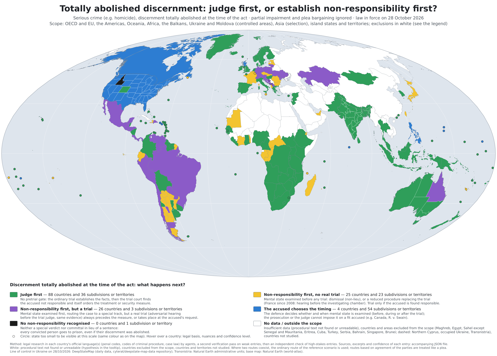

# Legal Insane Data

**When an accused's discernment was totally abolished at the time of the act: judge first, or establish
non-responsibility first?**

A world map, with its dataset, of what criminal procedure does with a person prosecuted for a serious crime
(e.g. a homicide) whose discernment, or control of their acts, was totally abolished by a mental disorder at
the time of the act. Law in force on 28 October 2026. A French edition is kept on the
[`francais`](https://github.com/ytrezq/Legal-Insane-Data./tree/francais) branch.



The SVG version (`maps/insanity_procedure_map.svg`) has a tooltip on every country and federated unit:
the rule, its legal basis, nuances and the confidence level.

## Colours

| Colour | Meaning | Countries | Subdivisions or territories |
|---|---|---:|---:|
| Green | **Judge first**: no pretrial gate; the ordinary trial establishes the facts, then the trial court finds the accused not responsible and orders the measure itself. | 88 | 36 |
| Yellow | **Non-responsibility first, no real trial**: mental state examined before any trial; dismissal, or a reduced procedure replacing the trial (e.g. France since 2008). | 25 | 23 |
| Purple | **Non-responsibility first, but a trial**: special track, but a real trial always precedes the measure, or takes place at the accused's request. | 26 | 3 |
| Blue | **The accused chooses the timing**: the defence decides whether and when mental state is examined (e.g. Canada, R. v. Swain). | 4 | 54 |
| Black | **No non-responsibility recognised**: every convicted person goes to prison. | 0 | 1 |
| White | **No data / outside the scope**. | 4 | 2 |

Colours are applied in the order black, blue, yellow, purple, green; diminished responsibility and plea
bargaining are ignored; fitness to stand trial is described but never decides the colour. Federal countries are
split by unit when the rule is sub-national (United States, Australia, United Kingdom, Argentina, India/Kerala,
Tanzania/Zanzibar, Bosnia and Herzegovina).

**Scope.** OECD and EU countries (except Turkey, and Northern Cyprus, which is under Turkish control), the
Americas (except Cuba), Oceania, Africa (except the Maghreb, Egypt, Eritrea and the Sahel other than Senegal
and Mauritania), the Balkans (except Serbia), Ukraine and Moldova (government-controlled areas), a selection
of Asian countries including Syria, Timor-Leste and the United Arab Emirates, and all island states and
territories except Cuba, Bahrain, Singapore and Brunei, which are left out by editorial choice: the Maldives,
Comoros, Jersey, Guernsey, the Isle of Man, the British territories in the Caribbean and the Atlantic
(Bermuda, Cayman Islands, British Virgin Islands, Anguilla, Montserrat, Turks and Caicos Islands, Falkland
Islands, Saint Helena), Aruba, Curaçao, Sint Maarten and the United States Virgin Islands. An
authoritarian regime is not excluded as such: what matters is whether, in ordinary criminal cases, the law on
the rights of the defence is still followed (corruption aside). Where the lack of rule of law makes the law
only a hint rather than a requirement, the jurisdiction is left out (see [CONTRIBUTING.md](CONTRIBUTING.md)).

**Still white for lack of a readable procedural text:** Benin, Equatorial Guinea, Guinea, Somalia, Zanzibar
and Guernsey. The tooltips and the JSON give the
unverified hypothesis when there is one. Contributions are especially welcome there.

## Files

| Path | Content |
|---|---|
| `data/insanity_procedure_map.json` | **The dataset** (English): 273 entries with facts, legal bases, a verbatim excerpt, notes, sources, confidence, history and independent checks; methodology, scope, field reference (`meta.schema`) and contribution rules. |
| `maps/insanity_procedure_map.svg` / `.jpg` | English map: interactive SVG and 3740 × 2680 JPG (10 megapixels). |
| `tools/` | Validation (`dataset.py`) and map generation (`build.sh`, Node.js + Python). |

## How the data was compiled

The dataset was compiled on 28 and 29 October 2026 by AI research agents (Anthropic's Claude) working for the
repository owner. Penal codes, codes of criminal procedure and case law were read in each jurisdiction's
official language(s); where the reading tool cut an official text short, the full text was downloaded and
read. A second pass verified weak entries, and agents that had not written the entries
independently checked 38 high-stakes ones (37 confirmed, 1 doubtful). A colour was assigned only when the
decisive procedural mechanism had actually been read; otherwise the entry stays white. This is a research
dataset, not legal advice: each entry carries its sources, a verbatim excerpt and a confidence level, so
please check them, and correct them through a pull request.

## Contributing

Pull requests on the JSON only. Read [CONTRIBUTING.md](CONTRIBUTING.md) for the classification rules, the
scope criterion and the evidence required. Every pull request is checked automatically. After a merge into
`main`, a workflow recomputes the derived fields and regenerates the English map.

To rebuild locally (Node.js 18+, Python 3 with Pillow):

```sh
python3 tools/dataset.py validate data/insanity_procedure_map.json
python3 tools/dataset.py refresh data/insanity_procedure_map.json
sh tools/build.sh
```

## French edition

The dataset was first written in French; that original working edition, its French map and French
documentation are kept on the [`francais`](https://github.com/ytrezq/Legal-Insane-Data./tree/francais) branch, which accepts pull requests in French on
its own JSON file. The English dataset on `main` was translated from it on 28 and 29 October 2026.

## Credits

Base map: [Natural Earth](https://www.naturalearthdata.com/) (public domain) via
[world-atlas](https://github.com/topojson/world-atlas); line of control in Ukraine on 28 October 2026:
DeepStateMap daily data ([cyterat/deepstate-map-data](https://github.com/cyterat/deepstate-map-data));
Transnistria: Natural Earth administrative units; country names:
[i18n-iso-countries](https://github.com/michaelwittig/node-i18n-iso-countries); projection:
[d3-geo-projection](https://github.com/d3/d3-geo-projection).
